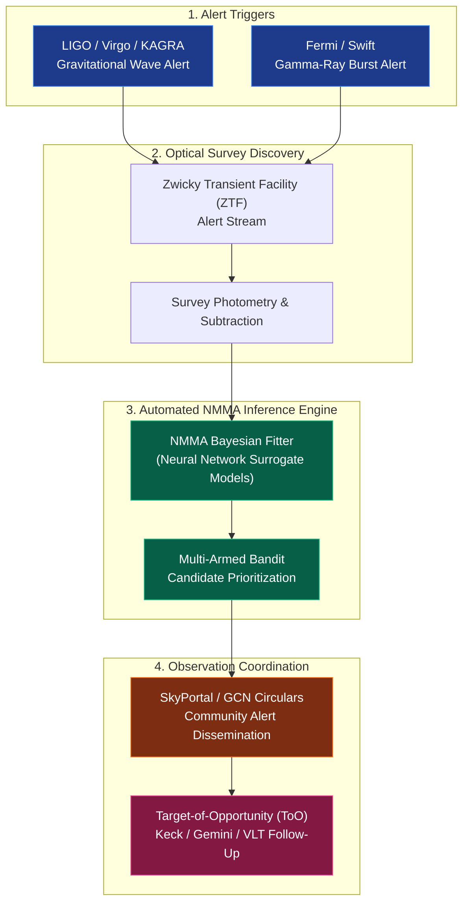

<!-- Interactive Feature Demo Header -->
<div class="alert alert-info" role="alert" style="background-color: var(--global-card-bg-color); border-left: 4px solid var(--global-theme-color); color: var(--global-text-color); margin-bottom: 2rem;">
  <strong>🚀 al-folio v1.x Interactive Feature Showcase</strong><br>
  This page demonstrates cutting-edge interactive components built into the modern al-folio theme: real-time photometric light curve plots, interactive workflow diagrams, multi-language code tabs, global research maps, and LaTeX math typesetting.
</div>

---

## 1. Interactive Transient Light Curve Visualizer
<p class="text-muted">
  Powered by <strong>Chart.js</strong>. Click on filter labels (<strong>ZTF-g</strong>, <strong>ZTF-r</strong>, <strong>ZTF-i</strong>, <strong>Kilonova Fit</strong>) in the legend below to toggle data streams and model comparisons dynamically!
</p>

<div class="card p-3 my-4" style="background: var(--global-card-bg-color); border: 1px solid var(--global-divider-color); border-radius: 8px;">
  <div style="position: relative; height: 380px; width: 100%;">
    <canvas id="lightcurveChart"></canvas>
  </div>
  <small class="text-center text-muted mt-2">
    Simulated fast-transient photometry and theoretical radioactive decay model curves ($\lambda_{\text{eff}} \in [4770, 7550]\,\text{Å}$).
  </small>
</div>

<!-- Chart.js CDN & interactive initialization script -->
<script src="https://cdn.jsdelivr.net/npm/chart.js@4.4.1/dist/chart.umd.min.js"></script>
<script>
  document.addEventListener("DOMContentLoaded", function() {
    const ctx = document.getElementById('lightcurveChart');
    if (!ctx) return;

    // Time array from 0 to 14 days
    const days = [0.5, 1.0, 1.5, 2.0, 2.8, 3.5, 4.2, 5.0, 6.5, 8.0, 10.0, 12.0, 14.0];

    // Theoretical model curves
    const knModelR = [19.2, 18.4, 18.2, 18.5, 19.1, 19.8, 20.4, 21.0, 21.8, 22.4, 22.9, 23.3, 23.6];
    const knModelG = [19.8, 19.1, 19.0, 19.6, 20.5, 21.3, 22.1, 22.8, 23.5, 24.1, 24.5, 24.8, 25.0];
    const knModelI = [19.5, 18.7, 18.3, 18.4, 18.8, 19.3, 19.8, 20.3, 21.0, 21.6, 22.1, 22.5, 22.8];

    // Photometric points with simulated observational noise
    const obsG = [
      {x: 0.6, y: 19.75}, {x: 1.1, y: 19.05}, {x: 2.1, y: 19.65},
      {x: 3.4, y: 21.20}, {x: 4.3, y: 22.25}, {x: 6.4, y: 23.45}
    ];
    const obsR = [
      {x: 0.5, y: 19.15}, {x: 1.0, y: 18.45}, {x: 1.6, y: 18.15},
      {x: 2.9, y: 19.05}, {x: 4.1, y: 20.35}, {x: 6.6, y: 21.85}, {x: 10.1, y: 22.85}
    ];
    const obsI = [
      {x: 1.1, y: 18.75}, {x: 2.0, y: 18.45}, {x: 3.6, y: 19.35},
      {x: 5.1, y: 20.30}, {x: 8.1, y: 21.55}, {x: 12.1, y: 22.45}
    ];

    new Chart(ctx, {
      type: 'line',
      data: {
        labels: days,
        datasets: [
          {
            label: 'ZTF-r Photometry (Observed)',
            data: obsR,
            borderColor: '#e74c3c',
            backgroundColor: '#e74c3c',
            showLine: false,
            pointRadius: 6,
            pointHoverRadius: 8,
            type: 'scatter'
          },
          {
            label: 'ZTF-g Photometry (Observed)',
            data: obsG,
            borderColor: '#2ecc71',
            backgroundColor: '#2ecc71',
            showLine: false,
            pointRadius: 6,
            pointHoverRadius: 8,
            type: 'scatter'
          },
          {
            label: 'ZTF-i Photometry (Observed)',
            data: obsI,
            borderColor: '#f39c12',
            backgroundColor: '#f39c12',
            showLine: false,
            pointRadius: 6,
            pointHoverRadius: 8,
            type: 'scatter'
          },
          {
            label: 'NMMA Kilonova Fit (r-band)',
            data: knModelR,
            borderColor: '#e74c3c',
            borderWidth: 2,
            borderDash: [5, 5],
            pointRadius: 0,
            fill: false,
            tension: 0.3
          },
          {
            label: 'NMMA Kilonova Fit (g-band)',
            data: knModelG,
            borderColor: '#2ecc71',
            borderWidth: 2,
            borderDash: [5, 5],
            pointRadius: 0,
            fill: false,
            tension: 0.3
          },
          {
            label: 'NMMA Kilonova Fit (i-band)',
            data: knModelI,
            borderColor: '#f39c12',
            borderWidth: 2,
            borderDash: [5, 5],
            pointRadius: 0,
            fill: false,
            tension: 0.3
          }
        ]
      },
      options: {
        responsive: true,
        maintainAspectRatio: false,
        scales: {
          x: {
            type: 'linear',
            position: 'bottom',
            title: {
              display: true,
              text: 'Time since trigger Δt (days)',
              font: { weight: 'bold', size: 13 }
            },
            min: 0,
            max: 15
          },
          y: {
            reverse: true, // In astronomical magnitudes, lower values are brighter
            title: {
              display: true,
              text: 'Apparent Magnitude (AB mag)',
              font: { weight: 'bold', size: 13 }
            },
            min: 17.5,
            max: 25.5
          }
        },
        plugins: {
          legend: {
            position: 'top',
            labels: {
              boxWidth: 14,
              usePointStyle: true,
              padding: 12
            }
          },
          tooltip: {
            callbacks: {
              label: function(context) {
                return `${context.dataset.label}: ${context.parsed.y.toFixed(2)} mag at t = ${context.parsed.x.toFixed(1)}d`;
              }
            }
          }
        }
      }
    });
  });
</script>

---

## 2. Multi-Messenger Rapid Response Architecture
<p class="text-muted">
  Rendered natively with <strong>Mermaid.js</strong>. Flowchart describing automated transient triage from gravitational-wave trigger to Target-of-Opportunity follow-up.
</p>



---

## 3. Multi-Platform Code Tabs
<p class="text-muted">
  Powered by <strong>jekyll-tabs</strong>. Easily showcase how to run your tools across Python, CLI, and HPC Slurm environments.
</p>




```python
from nmma.em import LightCurveFitter
import numpy as np

# Initialize the NMMA light curve fitting engine
fitter = LightCurveFitter(
    model="Bu2019lm",  # Bulla (2019) kilonova dynamical + wind ejecta model
    data_path="ztf_candidate_lightcurve.csv",
    nlive=512,
    priors={
        "log10_mej_dyn": [-3.0, -1.0],
        "log10_mej_wind": [-3.0, -0.7],
        "phi": [15, 75]
    }
)

# Run Bayesian parameter estimation via nested sampling
results = fitter.fit()
print(f"Estimated dynamical ejecta mass: {results.summary['mej_dyn']:.3e} M_sun")
```



```bash
# Run NMMA candidate inference directly from the terminal
nmma_fit \
  --data ./ztf_alerts/ZTF25abjmnps.csv \
  --model Bu2019lm \
  --prior-file priors/kilonova_default.prior \
  --nlive 1024 \
  --outdir ./fits/ZTF25abjmnps/ \
  --plot-lightcurves \
  --send-slack-alert
```



```bash
#!/bin/bash
#SBATCH --job-name=nmma_ztf_fit
#SBATCH --partition=msismall
#SBATCH --nodes=1
#SBATCH --ntasks=16
#SBATCH --time=02:00:00
#SBATCH --output=logs/nmma_%j.out

module load python/3.10
source activate nmma-env

# Execute parallel sampling across 16 CPU cores at MSI
mpirun -np 16 nmma_fit_parallel \
  --data ${SLURM_SUBMIT_DIR}/alerts/latest.csv \
  --model Me2017 \
  --outdir ${SLURM_SUBMIT_DIR}/results/
```




---

## 4. Interactive Research Journey Map
<p class="text-muted">
  Rendered using <strong>Leaflet.js</strong>. Explore research affiliations, observatories, and conference host institutions worldwide.
</p>

<link rel="stylesheet" href="https://unpkg.com/leaflet@1.9.4/dist/leaflet.css" />
<div id="research-map" style="height: 380px; width: 100%; border-radius: 8px; border: 1px solid var(--global-divider-color); margin: 1.5rem 0;"></div>
<script src="https://unpkg.com/leaflet@1.9.4/dist/leaflet.js"></script>

<script>
  document.addEventListener("DOMContentLoaded", function() {
    const mapContainer = document.getElementById('research-map');
    if (!mapContainer || typeof L === 'undefined') return;

    const map = L.map('research-map').setView([38.0, -40.0], 2);

    L.tileLayer('https://{s}.tile.openstreetmap.org/{z}/{x}/{y}.png', {
      maxZoom: 18,
      attribution: '© OpenStreetMap contributors'
    }).addTo(map);

    const locations = [
      { name: "University of Minnesota-Twin Cities", desc: "Ph.D. & M.S. Astrophysics | NMMA Pipeline Lead | Pepin Fellow", coords: [44.9778, -93.2650] },
      { name: "NASA Goddard Space Flight Center", desc: "Graduate Research Assistant | GCN Circulars & NLP Search", coords: [38.9959, -76.8526] },
      { name: "INAF - Italian National Institute for Astrophysics", desc: "Visiting Scholar (Spring 2026)", coords: [41.9028, 12.4964] },
      { name: "Rutgers University, New Brunswick", desc: "B.S. Astrophysics | Senior Honors Thesis (TESS SNe Ia)", coords: [40.5008, -74.4474] },
      { name: "Princeton University", desc: "Undergraduate Researcher | Kepler K2 Cluster Variables", coords: [40.3440, -74.6514] },
      { name: "W. M. Keck Observatory (Maunakea)", desc: "Remote Observing Shifts on Keck II", coords: [19.8260, -155.4681] },
      { name: "Kitt Peak National Observatory", desc: "Observational shift & multi-messenger follow-up", coords: [31.9583, -111.5967] }
    ];

    locations.forEach(loc => {
      L.marker(loc.coords)
        .addTo(map)
        .bindPopup(`<strong>${loc.name}</strong><br><span style="font-size:0.85rem">${loc.desc}</span>`);
    });
  });
</script>

---

## 5. Mathematical Formulations (MathJax / KaTeX)
<p class="text-muted">
  Al-folio seamlessly compiles both inline and block LaTeX equations.
</p>

In radioactive kilonova modeling, the energy generation rate from beta-decaying $r$-process nuclei is governed by:

$$
\dot{\epsilon}_{\text{radio}}(t) = \epsilon_0 \left(\frac{t}{1\,\text{day}}\right)^{-\alpha} \text{erg}\,\text{s}^{-1}\,\text{g}^{-1}
$$

The characteristic optical diffusion timescale $\tau_d$ of the ejecta depends on the opacity $\kappa$, ejecta mass $M_{\text{ej}}$, and expansion velocity $v_{\text{ej}}$:

$$
\tau_d = \sqrt{\frac{2 \kappa M_{\text{ej}}}{\beta c v_{\text{ej}}}} \approx 1.0\,\text{day} \left(\frac{\kappa}{1\,\text{cm}^2\,\text{g}^{-1}}\right)^{1/2} \left(\frac{M_{\text{ej}}}{0.01\,M_\odot}\right)^{1/2} \left(\frac{v_{\text{ej}}}{0.2\,c}\right)^{-1/2}
$$

---

## 6. Publications & Citation Integration
<p class="text-muted">
  Check out real-time citation tracking, BibTeX exports, and paper links on your <a href="{{ '/publications/' | relative_url }}">Publications Page</a> featuring <strong>BibSearch</strong> real-time filtering, Altmetric attention badges, and Google Scholar integration!
</p>
